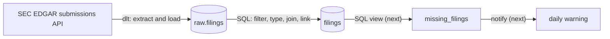
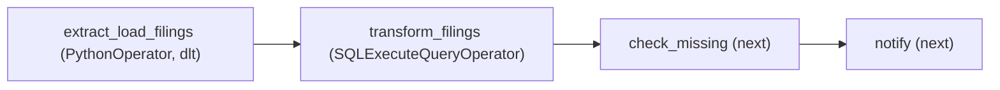

# Filings monitor

An Apache Airflow pipeline that pulls every new SEC filing for a small watchlist of companies into Postgres and keeps the forms an analyst cares about. Next on the roadmap: warn when a quarterly or annual report that was due has not arrived. Built as a learning project, one step at a time.

## The problem

An analyst following a handful of companies needs every new filing from them within the hour, every business day, without checking EDGAR by hand, and wants to be told when a 10-Q or 10-K that was due has not shown up.

## How it works

Airflow coordinates. dlt does the extract and load. Postgres does the transform.



The DAG today, with the steps still to come:



- **extract_load_filings:** for each company in `watchlist`, downloads its filing list from the SEC submissions API and merges the rows into `raw.filings`, keyed on the SEC's accession number, so a rerun updates instead of duplicating.
- **transform_filings:** rebuilds `filings` from the raw table: 10-K, 10-Q, 8-K and their amendments only, typed columns, joined to the watchlist for the ticker, with a link to each document.

## Run it

Needs Docker Desktop with about 8 GB of memory.

```bash
git clone https://github.com/GoodnessAzike/filings-monitor.git
cd filings-monitor
cp .env.example .env          # set WAREHOUSE_PASSWORD; on Mac or Linux set AIRFLOW_UID to the output of: id -u
docker compose up airflow-init
docker compose up --build -d
```

Then:

1. Put your name and email in `USER_AGENT` in `dags/include/sec_filings.py`. The SEC blocks requests that do not identify themselves.
2. Open http://localhost:8080 and log in with `airflow` / `airflow` (the default from the official Compose file; change it for anything shared).
3. Create the warehouse connection: Admin, Connections, Add. Connection Id `warehouse`, type Postgres, host `warehouse`, port `5432`, database `filings`, login `warehouse`, password as in your `.env`.
4. Load the watchlist: `docker compose exec -T warehouse psql -U warehouse -d filings < dags/sql/001_watchlist.sql`
5. Trigger `filings_monitor` in the UI.

Check the result:

```bash
docker compose exec warehouse psql -U warehouse -d filings -c "SELECT ticker, form, count(*) FROM filings GROUP BY ticker, form ORDER BY ticker, form"
```

## Layout

```
dags/filings_monitor.py        the DAG: imports, DAG object, tasks, arrows, nothing else
dags/include/sec_filings.py    extract and load, with dlt
dags/sql/001_watchlist.sql     the companies to follow
dags/sql/002_filings.sql       the transform
Dockerfile                     the official Airflow image plus dlt
docker-compose.yaml            Airflow's services plus the warehouse Postgres
.env.example                   the settings to copy into .env
```

## Design choices

| Choice | Why |
|---|---|
| dlt inside an Airflow task, not Airbyte | A few thousand rows a day do not need a platform. dlt handles the HTTP calls, the schema and the merge from one pip install, and Airflow stays a coordinator. |
| Transform in Postgres, not in Python | The database is built for it. The Airflow worker is not. |
| Merge on the accession number | It is the SEC's own unique id for a filing. Reruns update rather than duplicate. |
| The raw table keeps every form | Load everything, filter in SQL. The filter can change without downloading again. |
| `filings` is rebuilt in full each run | Small table, cheap query. Incremental loading can come when it grows. |
| Password in `.env`, Compose refers to it by name | Nothing secret in the repository. |
| SQL in files, not in Python strings | Easier to read, review and reuse. |

## What the source taught

- The SEC's "recent" list holds at least a thousand filings or one year, whichever is more. How far back it reaches depends on how much a company files: about eleven years for Apple, about one year for JPMorgan, whose list is mostly prospectus supplements.
- Every request needs a `User-Agent` header with a contact.
- The filing list arrives as parallel columns, not rows. The extract zips them into one row per filing.

## Roadmap

- [ ] `filing_deadlines` table and `missing_filings` view
- [ ] notify task that writes the daily warning
- [ ] hourly schedule on business days, with retries
- [ ] backfill from the UI
- [ ] pin the dlt version in the Dockerfile